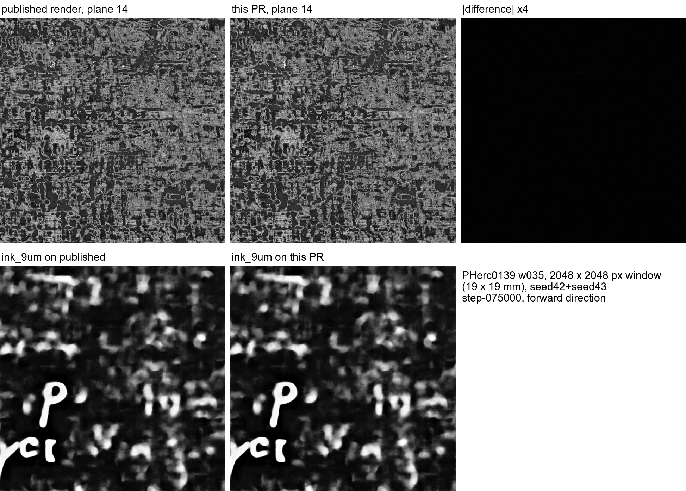

# 9 µm meshes, 2.4 µm scans

Vesuvius Challenge progress-prize submission, October 2026. The full write-up is [REPORT.md](REPORT.md).

- A Python renderer that turns any public tifxyz mesh plus a public scan into the flat surface volume ink inference reads (villa PR: https://github.com/ScrollPrize/villa/pull/2373).
- On held-out PHerc0841 and PHerc0009B, `ink_9um` scores 0.055–0.105 AUC lower on 9 µm-class scans than on the 2.4 µm scan of the same surface pooled to 9.6 µm.
- Automatic registration of a scroll's 9 µm and 2.4 µm scans, checked against the team's own mesh transfer (villa PR: https://github.com/ScrollPrize/villa/pull/2374).
- A survey of PHerc1203 (both scans) and PHerc0800 with `ink_9um`: no letters.

Layout:
- `scripts/`: evaluation, alignment, figure and mesh-transfer scripts used for the report
- `fig/`: figures referenced in the report
- `transforms/`: the two registrations, in the `foundation/volume-registration` transform JSON format

Every input is public: the Vesuvius Challenge open-data bucket and `scrollprize/ink_9um` (seed42 and seed43, step-075000).
