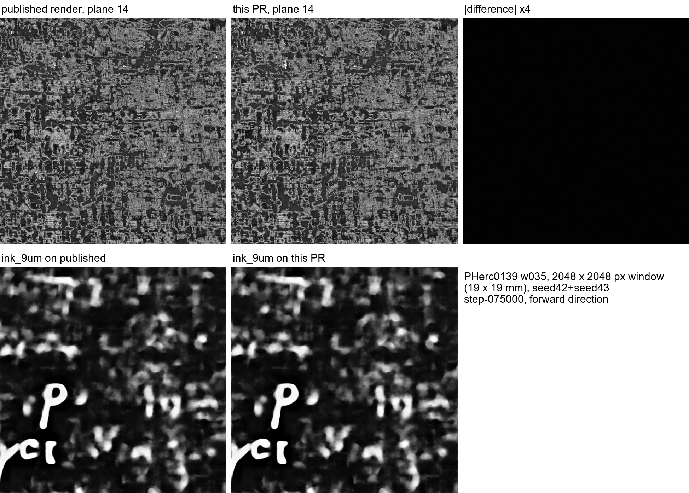
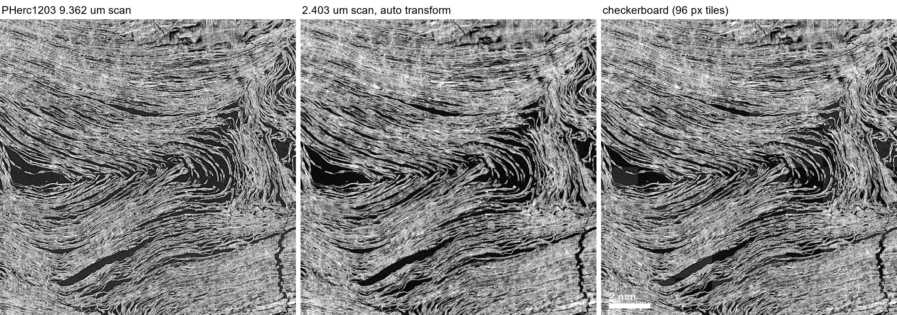

# 9 µm meshes, 2.4 µm scans: rendering, registration, and what a negative ink result means on First Letters scrolls

October 2026 progress-prize submission (draft).

## Summary

1. **Render any public mesh in Python** (`render_surface_volume`, villa PR): builds the flat surface volume that ink inference reads straight from a public tifxyz and a public scan, fetching only the chunks the mesh touches. It reproduces the published PHerc0139 w035 9.362 µm surface volume (per-plane median r 0.993–0.9999). With `--level 2`, it turns a 2.4 µm scan directly into the 9.6 µm `ink_9um` input without first rendering a 30+ GB full-resolution surface volume (AUC 0.870 vs 0.890 for the official route on held-out PHerc0841 w00).
2. **9 µm-class scans read worse than 2.4 µm scans, on scrolls the models never saw.** Same surface, same organiser labels, same `ink_9um` checkpoints (seed42+seed43 step-075000 ensemble). Native 8.64/9.366 µm renders score 0.055–0.105 AUC below the 2.4 µm scan pooled to 9.6 µm, on 4 of 4 segments from 2 scrolls. Interpolation and residual misregistration don't explain the gap. So a blank `ink_9um` result on a 9 µm render of an unread scroll is weak evidence of no ink.
3. **Automatic 9 µm ↔ 2.4 µm scan registration.** Coarse axial search, then 3D phase correlation at ~19 µm, then a robust affine. On PHerc0841 it agrees with the team's own mesh transfer (published 9.366 µm and 2.403 µm meshes of segment w00) to a median of 7.7 µm along the surface normal (p90 16 µm) over 99.7 % of vertices. It writes the `foundation/volume-registration` transform JSON.
4. **PHerc1203 (First Letters scroll), both scans.** I registered the 9.362 µm scan to the 2.403 µm partial scan, which covers about 30 mm of height. I rendered all 22 public `auto_grown` meshes, which had no surface volumes, from the 9.362 µm scan, and the parts inside the 2.4 µm band from the 2.403 µm scan. I ran `ink_9um` in both directions on all of them. No letters appear (contact sheets below). Combined with (2), the 9.362 µm renders are a weak test. The 2.4 µm-derived renders cover about 10 of the meshes substantially (12–80 % of vertices) and are the stronger negative.

Prize-rule note: for PHerc1203 the eligible First Letters and 2027 Grand Prize volume is the 9.362 µm scan (20250820131727), and the Grand Prize excludes data derived from higher-resolution scans of the submitted volume. So the 2.4 µm route is a diagnostic: it tells whether a blank 9 µm result comes from the scan resolution. Prize results have to come from ink detection that works on the 9 µm-class scan itself. The four held-out pairs in (2) give one surface and one label set at both resolutions, so they can measure progress on that gap directly.

## 1. Python surface-volume renderer

- Geometry: `self_render_tifxyz.surface_tile_geometry`, the vc_render_tifxyz conventions.
- Plane j samples `xyz + ((D−1)/2 − j)·normal`. I determined this by matching the published volume: the opposite plane order correlates at only r 0.94.
- Sampling is trilinear.
- Output is a v2 zarr group usable directly by `vesuvius.ink_detection.inference.infer`.

| check | result |
|---|---|
| PHerc0139 w035 whole segment vs published 9.362 µm surface volume (322 random 256 px tiles) | per-plane median r 0.993–0.9999, mean \|Δ\| 1.46 grey levels, coverage IoU 0.992 |
| PHerc0841 w00 `--level 2 --depth 21` vs official `prepare_9um_isotropic_input` | identical canvas 21×4115×4640, per-plane r 0.98; ink AUC 0.870 vs 0.890 |
| cost, PHerc1203 4640×5360 canvas | 1,473 chunks (3.1 GB) and ~5 min from S3 at level 0; ~50 s from the 2.4 µm scan at level 2 |
| unit tests | 8, including a level-2 test that a version without the pyramid voxel-centre shift fails |
| ink output, 2048 px window of w035 | `ink_9um` prediction on this render vs on the published render: r 0.992 (forward), 0.980 (reverse) |

## 2. Native 9 µm vs pooled 2.4 µm on held-out scrolls

Segments: the three PHerc0841 segments and one PHerc0009B segment that carry organiser ink labels on the open-data server. Neither scroll is in the `ink_9um` training set.

- The pooled input is `prepare_9um_isotropic_input` on the 2.4 µm surface volume.
- The native input is the published 8.64/9.366 µm surface volume of the same segment.
- I mapped the native canvas onto the labelled 2.4 µm level-2 canvas with the known pixel-size ratio plus a phase-correlation shift. The correlation peak was 420–550 σ; the shift was 6–8 px.
- AUC is computed inside the supervision mask, on pixels covered by both renders.

| segment | native scan | AUC native | AUC pooled 2.4 µm | pixels |
|---|---|---|---|---|
| PHerc0841 w00 | 9.366 µm | 0.790 | 0.890 | 1.52 M |
| PHerc0841 20260220214732 | 9.366 µm | 0.724 | 0.828 | 0.93 M |
| PHerc0841 20260221022814 | 9.366 µm | 0.776 | 0.833 | 1.22 M |
| PHerc0009B 20250919125754 | 8.64 µm | 0.832 | 0.887 | 2.77 M |

Checks:
- **Interpolation:** passing the pooled prediction through the same resampling round trip changes its AUC by less than 0.0003.
- **Registration:** the best ±2 px local shift of the native prediction gains at most 0.001.
- **Direction:** the reverse direction is near chance on both inputs (0.51–0.62).

Caveat: the labels were drawn on 2.4 µm renders, which may favour the pooled input. The visual difference points the same way (figure: `fig/pherc0841_w00_9um_vs_2p4.png`).

I also tested a label-free "depth profile contrast" diagnostic, meant to say whether a render looks like the training renders. It is only weakly related to per-tile AUC on held-out tiles (Spearman 0.17–0.24, n = 212). Its values on PHerc0841, where ink is readable, overlap those on PHerc1203. I report it as a negative result.

## 3. Automatic registration of two scans of one scroll

`auto_register.py --fixed SCAN_9UM --moving SCAN_2P4 --output-transform OUT_JSON`:
1. Coarse search: one moving axial slice against every 10th fixed axial slice at ~75 µm voxels, over 180 angles × 2 mirrors, with FFT translation. The rotation sense is then picked by trial 3D matches.
2. Fine matching: 3D phase correlation of ~19 µm cubes at ~120 points, with sub-voxel peaks.
3. Fit: iteratively reweighted least-squares affine, then one refinement pass seeded by the fit.

| pair | coarse | inliers | median residual | scale vs pixel-size ratio | check against team |
|---|---|---|---|---|---|
| PHerc1203 9.362 ← 2.403 µm | z 1240 (L3), 0° | 38/38 | 0.87 vox (8 µm) | 0.25668 vs 0.25668 | – |
| PHerc0841 9.366 ← 2.403 µm | z 1840 (L3), 0° | 17/22 | 1.51 vox | 0.25659 vs 0.25657 | w00 mesh: normal 7.7 µm median, 16 µm p90; in-plane 4.8 µm |

PHerc1203, one axial plane in the middle of the 2.4 µm band: the 2.403 µm scan resampled through the automatic transform continues the sheets of the 9.362 µm scan across every checkerboard edge (pixel r 0.83 at ~19 µm).

## 4. PHerc1203 survey

- 22 meshes from `PHerc1203/segments/raw/`, 3–16 cm² each, rendered at 9.362 µm with 28 planes.
- `ink_9um` seed42+seed43 step-075000, both directions, 50 % overlap, Hann blending.
- After registration, the same meshes were mapped into the 2.403 µm scan, rendered at level 2 with 21 planes, and inferred the same way.
- Check that the mapped meshes land on the same papyrus: for the largest mesh, the 9 µm render and the 2.4 µm-derived render agree to within 1 px after canvas scaling (high-pass r 0.79).
- Result: no letter-like rows in either set, in either direction. The images are in `fig/`.
- PHerc0800: its 6 `auto_grown` meshes (2 cm squares, 8.64 µm only) are also blank.

What would make the negative stronger:
- full-resolution 2.4 µm renders with `ink_canonical_2um`
- meshes inside the 2.4 µm band rather than mostly below it

Both are now cheap with (1) and (3).

## Reproduce

Environment: Windows 11, RTX 4070, Python 3.14, torch 2.14.1+cu130, villa `main` (results produced at 382e48d35; both PR branches rebased onto 8ff06f762 and re-tested) plus the two PR branches. Every input comes from the public open-data bucket and `scrollprize/ink_9um` (seed42 and seed43, step-075000).

| step | command |
|---|---|
| render a mesh | `python -m vesuvius.ink_detection.preprocessing.render_surface_volume MESH SCAN out.zarr [--level 2 --depth 21]` |
| ink | `python -m vesuvius.ink_detection.inference.infer out.zarr seed42.pth pred.tif --ensemble-checkpoint seed43.pth --direction both` |
| register scans | `python foundation/volume-registration/auto_register.py --fixed SCAN_9UM --moving SCAN_2P4 --output-transform t.json` |
| move a 9 µm mesh to the 2.4 µm scan | `scripts/transform_mesh.py MESH_9UM out_mesh t.json` |
| check a transfer against a published mesh | `scripts/validate_transfer.py MESH_9UM MESH_2P4 t.json` |
| held-out AUC, pooled 2.4 µm | `scripts/heldout_run.sh SEG_DIR` (pool, infer, `heldout_eval.py`) |
| held-out AUC, native vs pooled | `scripts/native_align.py`, then `scripts/native_robust.py` |
| depth-profile diagnostic | `scripts/depth_profile.py` |
| contact sheets | `scripts/sheet.py` |
| renderer and registration figures | `scripts/prfig_render_prep.py`, then infer, then `scripts/prfig_render.py`; `scripts/prfig_register.py` |

Figures in `fig/`:
- `w035_render_vs_published.png`
- `pherc1203_registration_checkerboard.png`
- `pherc0841_w00_9um_vs_2p4.png`
- `pherc1203_2p4_survey_*.png`
- `pherc1203_9um_survey_*.png`
- `pherc0800_survey_*.png`

Transforms: `transforms/pherc1203_2p403_to_9p362.json` and `transforms/pherc0841_2p403_to_9p366.json`.
